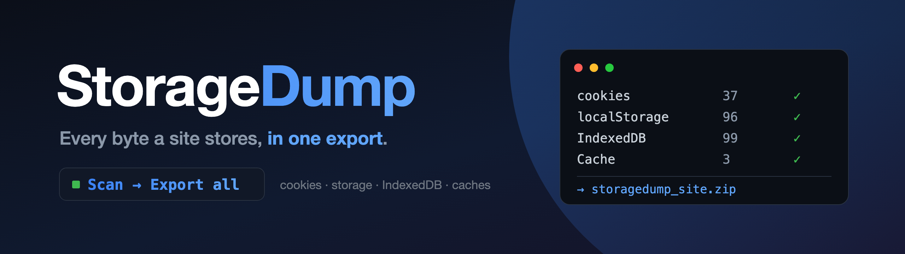

<p align="center">
  
</p>

<p align="center">
  <a href="https://chromewebstore.google.com/detail/storagedump/kihoghfekemdccfnpjefmggehpgnjnab"></a>
  
  
  
  <a href="AGENTS.md"></a>
  
</p>

<p align="center">
  <code>chrome-extension</code> <code>cookies</code> <code>httponly-cookies</code> <code>localstorage</code> <code>indexeddb</code>
  <code>cache-storage</code> <code>browser-storage</code> <code>devtools</code> <code>export-cookies</code> <code>privacy</code>
</p>

# StorageDump

StorageDump is a free, open-source Chrome extension that inspects and exports everything a website stores in your browser — cookies (including HttpOnly and partitioned), localStorage, sessionStorage, IndexedDB, Cache Storage and service workers — as lossless JSON or ZIP, entirely on your machine.

**[Install from the Chrome Web Store](https://chromewebstore.google.com/detail/storagedump/kihoghfekemdccfnpjefmggehpgnjnab)** · [Docs](https://nsozturk.github.io/storagedump/) · [Website](https://storagedump.lamma.dev)

## What it does

| Storage | What you get |
|---|---|
| Cookies | Every cookie for the host, any `Path`, including **HttpOnly** and **partitioned (CHIPS)** cookies, with all flags |
| localStorage / sessionStorage | All frames of the tab, including cross-origin iframes; values exported byte-for-byte (no lossy JSON re-parsing) |
| IndexedDB | Every database and object store; `Map`, `Set`, `BigInt`, dates and cyclic records preserved |
| Cache Storage | Every cached request with status and headers; text bodies, binary bodies as base64 (optional) |
| Service Workers | Registrations, scopes and worker states |
| Extension storage | `chrome.storage.local` / `sync` of StorageDump itself, kept separate |

- **One-click export** — JSON or a ZIP with a manifest, per-category files and automatic splitting of large files.
- **Dashboard** — browse each category, drill into IndexedDB stores, edit or delete entries, review export history (with SHA-256 checksums).
- **Optional masking** of keys that look like tokens, sessions or passwords.
- **On demand only** — nothing is read until you click Scan. No server, no analytics; exports go to your Downloads folder.

## Install

**Chrome Web Store:** [StorageDump](https://chromewebstore.google.com/detail/storagedump/kihoghfekemdccfnpjefmggehpgnjnab)

**From source:**

```bash
npm install
npm run build
```

Open `chrome://extensions`, enable **Developer mode**, click **Load unpacked** and choose `dist/`.

## Usage

1. Open the site you want to inspect.
2. Click the StorageDump icon → **Scan**.
3. **Export all**, or **Open dashboard** to browse, edit and export single categories.

## Permissions

| Permission | Why |
|---|---|
| `<all_urls>`, `scripting`, `activeTab` | Read the storage of the site you are inspecting — only when you click |
| `cookies` | List cookies, including HttpOnly ones the page itself cannot see |
| `downloads` | Save the export to your Downloads folder |
| `storage` | Settings and export history (metadata only) |
| `tabs` | Find the tab you are inspecting; clear its badge when it navigates |

Details: [Privacy policy](https://storagedump.lamma.dev/privacy) · [docs/permissions.md](docs/permissions.md) · [docs/privacy.md](docs/privacy.md)

## Development

```bash
npm run typecheck
npm test            # unit tests (Vitest)
npm run test:e2e    # dashboard end-to-end + layout-stability test
npm run pack        # production build + Chrome Web Store zip (storagedump.zip)
```

### Dashboard E2E test

`tests/e2e/dashboard.e2e.mjs` loads the built extension into Playwright's Chromium
(`npx playwright install chromium` once), opens the fixture site and drives the
dashboard: every category view, IndexedDB drill-down, mutations, export,
history, settings, a restricted tab and the badge. It also checks for UI jitter:
layout shift on load (CLS ≤ 0.05), shell elements sampled every frame while
switching views/refreshing (≤ 1 px movement), button widths in busy state, and
horizontal overflow at 1440/1024/760 px. Run it after every dashboard change;
`--headed` shows the browser (the two export cases are skipped there, since
`saveAs` opens a native dialog); failures leave screenshots in
`tmp-smoke-artifacts/e2e/`.

### Architecture

React 19 + TypeScript + Vite, Manifest V3.

- `src/runtime/inpage.ts` — injected into the inspected tab on demand; reads localStorage, sessionStorage, IndexedDB, Cache Storage and service workers.
- `src/background/index.ts` — service worker: cookies, all-frames storage, export (JSON/ZIP), settings, history, badge.
- `src/ui/` — popup, dashboard and options pages.

Product notes: [README-StorageDump.md](README-StorageDump.md). Agent contract: [AGENTS.md](AGENTS.md).

## FAQ

### How do I export all cookies, including HttpOnly ones, from Chrome?
Open the site, click StorageDump → **Scan** → **Export all** (or export only the Cookies category from the dashboard). HttpOnly and partitioned cookies are read through the extension cookies API, so they are included.

### How do I export localStorage and IndexedDB for a site?
Scan the site and export. localStorage values are kept exactly as stored, and IndexedDB records keep `Map`, `Set`, `BigInt` and cyclic structures instead of silently flattening them.

### Does StorageDump send my data anywhere?
No. There is no StorageDump server and no analytics. Exports are written locally through the Chrome downloads API.

### Why does it need access to all sites?
Because you can inspect any site you visit. Storage is read only when you click Scan in the popup or dashboard — never in the background.

### Is StorageDump an alternative to EditThisCookie or Get cookies.txt LOCALLY?
Yes, for inspecting and exporting cookies — and it also covers localStorage, sessionStorage, IndexedDB, Cache Storage and service workers in the same export.

## Alternatives / compared with

| Tool | Covers |
|---|---|
| Chrome DevTools → Application panel | Inspect all storage, one category at a time; no single export |
| EditThisCookie, Cookie-Editor | Cookies only |
| Get cookies.txt LOCALLY | Cookie export in Netscape format only |
| **StorageDump** | All of the above storage types, inspected together and exported in one JSON/ZIP |

## License

[MIT](LICENSE) © 2026 Enes Öztürk
